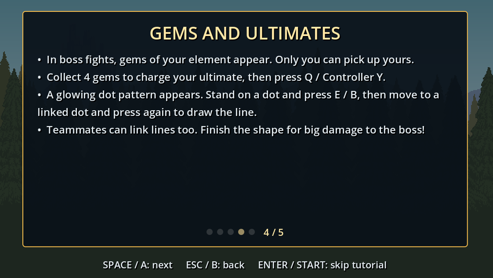

This week on elemental dungeon we had the milestone done but still had the upcoming playtest to figure out what all we wanted to get tested before that happened. We decided on a tutorial to explain the elemental attack and a second puzzle for that maze that used a pressure plate to add a level of difficulty to the maze because we felt that it was too easy.

This week I worked around 8 hours in total before friday which was more than the 4-6 I had estimated. But there was a lot that needed done and we were able to achieve it all for the playtest because we felt that was the most important thing that we needed to do.

## Maze

The maze was having an issue with the players getting stuck on each other at the exit so I needed to put it where the players are able to pass through each other in the maze for them to be all able to reach the exit

## New Code

One of the tutorial screens

